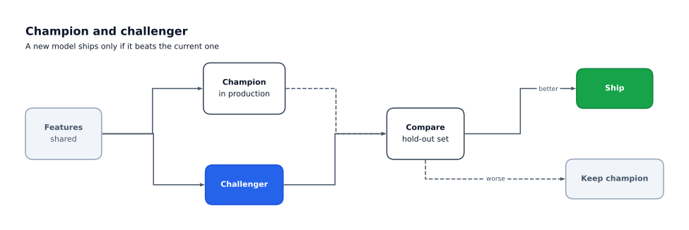
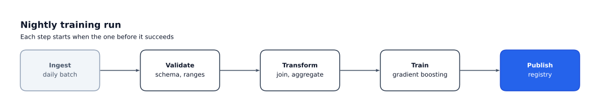
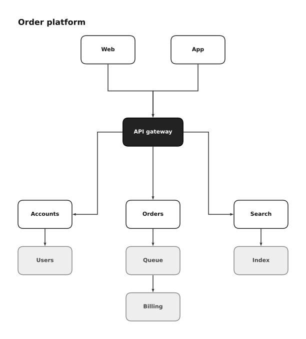

<!--
  Hand-written. README.md is a forge "replace" file, so regenerating the project
  with forge overwrites it: restore this version from git afterwards.
-->

# flowgram

Presentation-quality diagrams from a short Python spec.

You describe boxes, the rows and columns they sit in, and the edges between them.
flowgram sizes everything to fit its text, lines it up, routes the edges and draws
the result with matplotlib, ready for a slide, a report or a notebook.



flowgram is for the hand-arranged diagrams you would otherwise draw in slide
software: pipelines, model flows and process overviews. It is not a graph-layout
engine; you choose the layout, and flowgram makes it neat.

## Install

```bash
pip install flowgram
```

Or with uv, `uv add flowgram`. Loading specs from YAML needs the `yaml` extra:
`pip install "flowgram[yaml]"`. flowgram needs Python 3.11 or newer, and its only
dependencies are pydantic and matplotlib.

## Quick start

```python
from flowgram import Box, Column, Diagram, Edge, Row

spec = Diagram(
    title="Model training pipeline",
    root=Row(
        gap=2,
        children=[
            Box(id="data", label="Raw data", role="muted"),
            Column(
                gap=1,
                children=[
                    Box(id="clean", label="Clean", subtitle="impute, clip"),
                    Box(id="feats", label="Features"),
                ],
            ),
            Box(id="model", label="Model", role="accent"),
        ],
    ),
    edges=[
        Edge(src="data", dst="clean"),
        Edge(src="data", dst="feats"),
        Edge(src="clean", dst="model", label="train"),
        Edge(src="feats", dst="model", style="dashed"),
    ],
)

spec.save("pipeline.png")  # or .svg, or .pdf
```

That writes `pipeline.png`, at 300 dpi. In Jupyter, put `spec` last in a cell and
the diagram shows itself.

### The pieces

- **`Box`** holds a `label`, and optionally a `subtitle` under it and an `eyebrow`
  over it. Use `\n` for line breaks. Its `role` picks its colours from the theme:
  `default`, `accent`, `muted`, `positive` or `negative`.
- **`Row`** and **`Column`** lay their children out side by side or top to bottom,
  with a `gap` between them. They nest to any depth. `align` lines children up
  across the row or column, and `uniform=True` gives every box the size of the
  largest. **`Spacer`** adds empty space.
- **`Edge`** joins two boxes by `id`. It leaves and enters on the sides that face
  each other, as a straight line or an elbow. Set `exit`, `entry` or `routing` to
  choose for yourself, plus `label`, `style` (`"dashed"`, `"dotted"`) and `arrow`.
- **`Theme`** sets the colours, fonts and spacing. Start from `Theme.light()`
  (the default) or `Theme.mono()`, and change what you need with
  `model_copy(update={...})`.

Specs are immutable and checked when they are built. A mistake, such as an edge
to a box that does not exist, reports every problem at once, with the valid
choices.

### Saving and loading

`spec.save(path)` picks PNG, SVG or PDF from the file's extension. Saving the same
spec twice gives the same bytes. `spec.render()` returns a matplotlib `Figure`, and
`spec.draw(ax)` draws into an `Axes` you already have.

A spec can also live in a data file. Every component names its `kind`:

```yaml
title: Model training pipeline
root:
  kind: row
  children:
    - {kind: box, id: data, label: Raw data, role: muted}
    - {kind: box, id: model, label: Model, role: accent}
edges:
  - {src: data, dst: model}
```

```python
from flowgram import Diagram

spec = Diagram.from_yaml_file("pipeline.yaml")  # needs flowgram[yaml]
spec = Diagram.from_json_file("pipeline.json")  # or from_dict, from_json
```

## Gallery

Each image links to the script that draws it. `examples/gallery.ipynb` builds them
all in Jupyter.

[](https://github.com/Sandsy09/flowgram/blob/main/examples/linear_pipeline.py)

**[Linear pipeline](https://github.com/Sandsy09/flowgram/blob/main/examples/linear_pipeline.py):**
five steps in a row, sized evenly.

[](https://github.com/Sandsy09/flowgram/blob/main/examples/branching_flow.py)

**[Branching model flow](https://github.com/Sandsy09/flowgram/blob/main/examples/branching_flow.py):**
edges fan out and back in, with labelled outcomes.

[](https://github.com/Sandsy09/flowgram/blob/main/examples/nested_layout.py)

**[Nested layout](https://github.com/Sandsy09/flowgram/blob/main/examples/nested_layout.py):**
columns in a row in a column, in the mono theme.

## Known limits

- **Edges do not avoid boxes.** An edge takes the direct straight or elbow route,
  even through a third box. Rearrange the layout, or set `exit`, `entry` and
  `routing`.
- **Edges on one side of a box share one anchor**, so they overlap until they turn.
- **Text does not wrap.** Put `\n` where a line should break.

## Stability

flowgram is before 1.0. Until then, a minor release (0.1 to 0.2) may change the
Python API or the spec format, and the changelog says how to update. Patch releases
do not. Pin a minor version, such as `flowgram>=0.1,<0.2`, if you depend on it.

## Documentation

The user guide and API reference are at <https://sandsy09.github.io/flowgram/>.

## Development

```bash
git clone https://github.com/Sandsy09/flowgram.git
cd flowgram
uv sync --all-groups --locked
uv run --locked poe check   # lock, format, lint, types, tests, coverage, notebooks
```

Tasks live in `pyproject.toml` under `[tool.poe.tasks]`. `uv run poe docs` serves the
docs, and `uv run poe gallery` rebuilds the gallery images and notebook after an
example changes. Snapshot tests run on Linux with `uv run poe test:snapshots`. Notebooks
are committed with their outputs cleared. `poe notebook:check` runs them, with the same
access to your machine as any other code.

See [CONTRIBUTING.md](https://github.com/Sandsy09/flowgram/blob/main/CONTRIBUTING.md) for the workflow. Report security issues as
[SECURITY.md](https://github.com/Sandsy09/flowgram/blob/main/SECURITY.md) describes, not in a public issue.

## License

MIT. See [LICENSE](https://github.com/Sandsy09/flowgram/blob/main/LICENSE).
