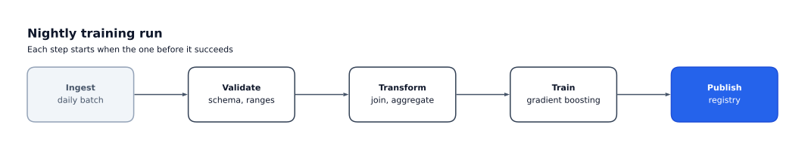
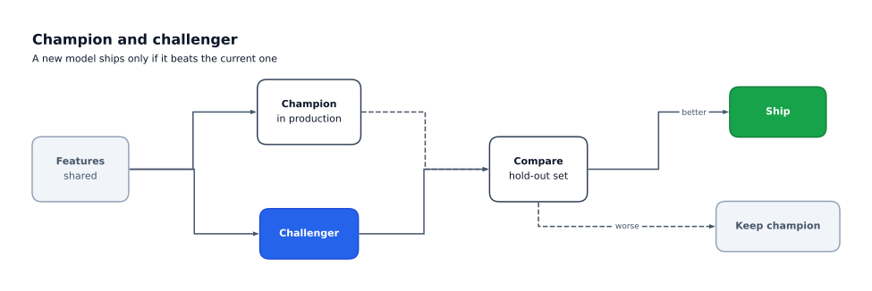
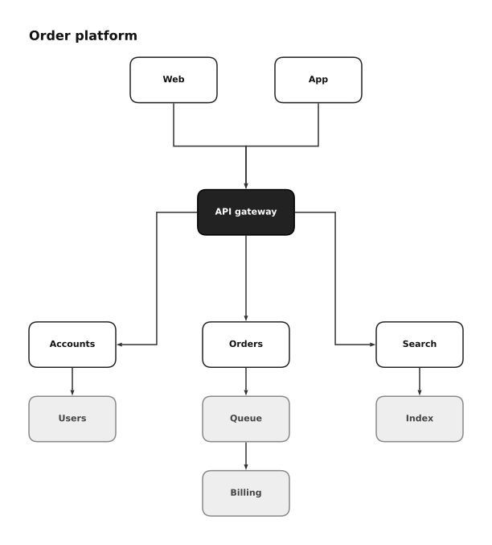

# Gallery

Three diagrams, each built by a short script in
[`examples/`](https://github.com/Sandsy09/flowgram/tree/main/examples). Run a script
to write its diagram as a PNG next to it, or open `examples/gallery.ipynb` to build
them all in Jupyter.

## Linear pipeline



<!-- fmt: off -->
```python
--8<-- "examples/linear_pipeline.py"
```
<!-- fmt: on -->

## Branching model flow



<!-- fmt: off -->
```python
--8<-- "examples/branching_flow.py"
```
<!-- fmt: on -->

## Nested layout



<!-- fmt: off -->
```python
--8<-- "examples/nested_layout.py"
```
<!-- fmt: on -->

The images are written by `uv run poe gallery`, with their text drawn as shapes so
they look the same in any browser.
