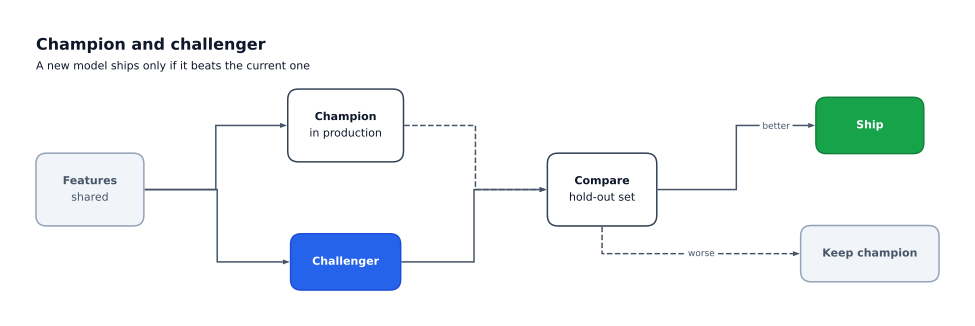

# flowgram

Presentation-quality diagrams from a short Python spec.

You describe boxes, the rows and columns they sit in, and the edges between them.
flowgram sizes everything to fit its text, lines it up, routes the edges and draws
the result with matplotlib, ready for a slide, a report or a notebook.



## Install

```bash
pip install flowgram
```

Loading YAML specs needs the `yaml` extra: `pip install "flowgram[yaml]"`.
flowgram needs Python 3.11 or newer.

## Quick start

```python
from flowgram import Box, Column, Diagram, Edge, Row

spec = Diagram(
    title="Model training pipeline",
    root=Row(
        gap=2,
        children=[
            Box(id="data", label="Raw data", role="muted"),
            Column(
                gap=1,
                children=[
                    Box(id="clean", label="Clean", subtitle="impute, clip"),
                    Box(id="feats", label="Features"),
                ],
            ),
            Box(id="model", label="Model", role="accent"),
        ],
    ),
    edges=[
        Edge(src="data", dst="clean"),
        Edge(src="data", dst="feats"),
        Edge(src="clean", dst="model", label="train"),
        Edge(src="feats", dst="model", style="dashed"),
    ],
)

spec.save("pipeline.png")  # or .svg, or .pdf
```

In Jupyter, put `spec` last in a cell and the diagram shows itself.

## Where next

- [Concepts](guide/concepts.md): the spec tree, edges, checking and units.
- [Layout](guide/layout.md): box sizes, rows, columns, spacers and `uniform`.
- [Edges](guide/edges.md): sides, routes, labels and styles.
- [Themes](guide/themes.md): roles, presets and making your own.
- [Export](guide/export.md): PNG, SVG and PDF, and identical files.
- [Loading specs](guide/loading.md): JSON and YAML.
- [Jupyter and PowerPoint](guide/jupyter-and-powerpoint.md): display formats and
  slides.
- [Known limits](guide/limits.md) in 0.1.
- [Gallery](gallery/index.md) and the [API reference](reference.md).

flowgram is before 1.0: a minor release may change the API or the spec format, so
pin a minor version, such as `flowgram>=0.1,<0.2`.
